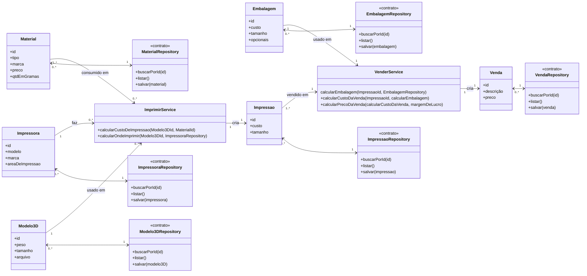

# Modelagem — Projeto 1

**Aluno(a):** Francisco Felipe Vieira de Oliveira  
**Domínio:** Calculadora e Banco de Impressões, Modelos e Materiais para Impressões 3D

## 1. O domínio

A partir do custo de material, tipo de material e tempo de impressão de um modelo 3D é possível gerenciar preços e disponibilidade de impressoras e embalagens e manter a oficina funcionando eficientemente.

## 2. Entidades

| Entidade | Atributos | Relacionamentos |
|---|---|---|
| Impressora | id, modelo, marca, areaDeImpressao | responsável por realizar impressões |
| Material | id, tipo, marca, preco | consumido na impressão |
| Modelo3D | id, peso, tamanho, tempoDeImpressao | modelo usado para impressões |
| Impressao | id, custo, tamanho | impressão finalizada |
| Embalagem | id, custo, tamanho, opcionais | embalagem para embalar a impressão |
| Venda | id, preco, custo, lucro | venda finalizada

## 3. Diagrama de classes

## 4. Responsabilidades

| Classe | Papel | Único motivo para mudar |
|---|---|---|
| Material, Impressora, Modelo3D, Impressao, Embalagem, Venda | entidades | as regras do próprio objeto |
| ImprimirService, VenderService | regra de negócio | o processo de imprimir e vender |
| MaterialRepository, ImpressoraRepository, Modelo3DRepository, ImpressaoRepository, EmbalagemRepository, VendaRepository | acesso aos dados | a forma de guardar (memória na S3, SQLite na S5) |

## 5. Onde apliquei SRP e DIP

- **SRP:** nenhuma entidade salva a si mesma nem envia e-mail. Guardar é papel dos
  repositories; os processos ficam no ImprimirService e VenderService.
- **DIP:** ImprimirService e VenderService depende dos contratos dos repositories recebidos pelo construtor. Ele não sabe se os dados estão em memória ou em um banco.

## 6. Fora do escopo (YAGNI)

Devoluções e falhas de impressão não entram no Projeto 1.
