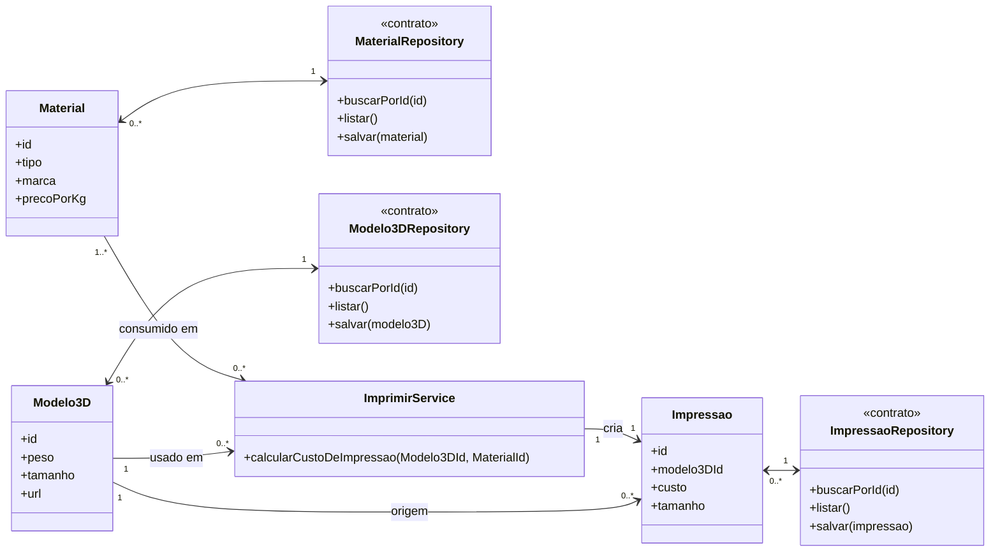

# Modelagem — Projeto 1

**Aluno(a):** Francisco Felipe Vieira de Oliveira  
**Domínio:** Calculadora e Banco de Impressões, Modelos e Materiais para Impressões 3D

## 1. O domínio

A partir do preço por kg do material e do peso em gramas do modelo 3D é possível calcular o custo de filamento de cada impressão.

## 2. Entidades

| Entidade | Atributos | Relacionamentos |
|---|---|---|
| Material | id, tipo, marca, precoPorKg | consumido na impressão |
| Modelo3D | id, peso, tamanho, url | modelo usado para impressões |
| Impressao | id, modelo3DId, materialId, custo, tamanho | impressão de um modelo 3D |

## 3. Diagrama de classes

## 4. Responsabilidades

| Classe | Papel | Único motivo para mudar |
|---|---|---|
| Material, Modelo3D, Impressao | entidades | as regras do próprio objeto |
| ImprimirService | regra de negócio | o processo de imprimir |
| MaterialRepository, Modelo3DRepository, ImpressaoRepository | acesso aos dados | a forma de guardar (memória na S3, SQLite na S5) |

## 5. Onde apliquei SRP e DIP

- **SRP:** nenhuma entidade salva a si mesma. Guardar é papel dos repositories;
  o processo de cálculo fica no ImprimirService.
- **DIP:** ImprimirService depende dos contratos dos repositories recebidos pelo
  construtor. Ele não sabe se os dados estão em memória ou em um banco.
- **Cálculo do custo:** `custo = (precoPorKg / 1000) * pesoEmGramas`.

## 6. Fora do escopo (YAGNI)

Devoluções e falhas de impressão não entram no Projeto 1.
